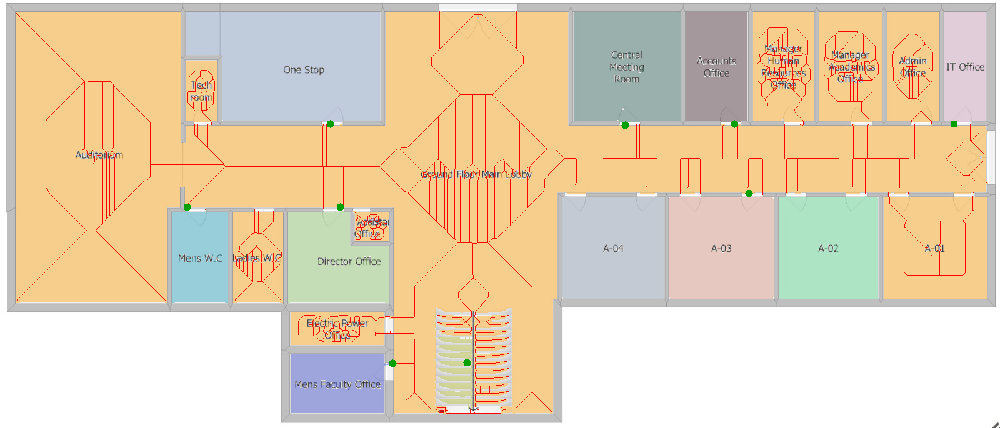
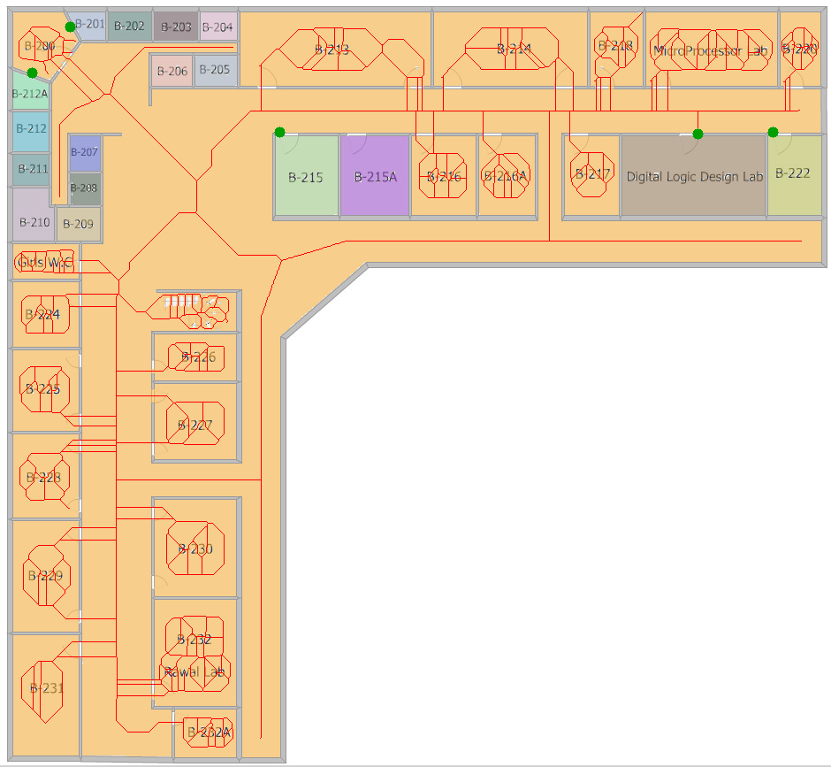

# FAST Floor Plan Inventory (`Floor_Plans_2.pdf`)

Status: first-pass manual inspection (2026-10-04, in claude.ai). **Prompt 1 in Claude Code must verify and correct this**, not trust it.

- File: `Floor_Plans_2.pdf`, 8 pages, A4 portrait, 2.7 MB
- SHA-256: `8316d9d778c7468d54d3de471216a95c5d340b5f9d95c1ddc2656a47070cd38d`
- Metadata: title "Floor Plans", author "Syed Muhammad Saad Salman", made in **Microsoft Word** and exported by macOS Quartz, 2023-08-16.

## 1. Headline findings

1. **It's all raster.** No vector drawings on any page (`get_drawings()` = 0). Each floor is an embedded PNG (one JPEG) screenshot, about 950–1650 px wide. The only text layer is the Word captions ("C-Block Ground Floor" etc.), which conveniently gives the page → floor mapping.
2. **These are diagrams, not architectural drawings.** They look like exports from a consumer floor-planner tool, pasted into a Word document by a student/staff member. There is **no scale bar, no dimensions and no north arrow**, and they may not be drawn to true scale. Two consequences:
   - scale must come from on-site measurements; take **several per floor, on both axes**, because x and y proportions may differ;
   - for positioning, the walls and walkable area are only as accurate as these drawings. Measure before trusting them as particle-filter constraints.
3. **Very clean, consistent rendering. This is good news for the classical baseline.** Grey levels across all floors: floor ≈ **238**, background ≈ **255**, wall fill ≈ **191**, wall outline ≈ **153**. Doors are drawn as an arc plus a thin white "slab" (≈242–255) bounded by 1 px grey lines inside the wall gap. Stairs use a grey/white step texture with an arrow; lifts are labelled "Elevator".
4. **Room labels are clean, horizontal text** (A-104, B-215A, C509 …), plus some rotated labels (C-block washrooms/kitchen). OCR should work well. C-block 2nd and 5th floors have labels re-typed in a serif font over the image, and the 5th floor has a cyan highlight box around the hallway. Both are noise to handle.
5. **Each floor has its own pixel scale.** For example, C-block floor images are 949, 1379, 990, 992 and 1642 px wide for similar footprints. Scale is therefore per floor, never per building.
6. **Page 1 is a campus site plan** (gates, blocks, lawns, the C↔B bridge and B↔A link). It isn't a floor to route inside yet, but it's the future source for inter-block / outdoor connections.

## 2. Per-page table

| Page | Image(s) | Content | px (w×h) | Notes |
|---|---|---|---|---|
| 1 | p1_0 | Campus site plan (Gates 1–4, A/B/C blocks, lawns, sports) | 1326×1250 | Outdoor context; blocks drawn as faded floor plans. Not a routing floor in v1 |
| 2 | p2_0 | **A Block Ground Floor** | 1600×685 | Large lobby + T-shaped corridor, auditorium, offices A-01..A-04, central stair |
| 2 | p2_1 | A Block First Floor | 1600×680 | Many small sub-rooms (A-114A–G, A-115A–F) — hard for room splitting |
| 3 | p3_0 | A Block Second Floor | 1600×690 | Similar layout; cluster of A-209/216 sub-rooms |
| 3 | p3_1 | A Block Third Floor | 1600×688 | Labs (Karakoram, Mehran, CALL) |
| 4 | p4_0 | **B Block Ground Floor** | 1078×931 | L-shaped corridor with diagonal walls; cyan line at top edge; image **cropped at bottom** (B-34 cut off) |
| 4 | p4_1 | B Block First Floor | 940×867 | L-shape, diagonal walls, stairwell inside corridor island |
| 5 | p5_0 | B Block Second Floor | 1021×933 | L-shape; cyan line at top; "Stationary Shop" open area |
| 6 | p6_0 | C-Block Basement 1 | 968×557 | Big open cafeteria (wide open area → skeleton spurs), 2 stairs, 2 lifts |
| 6 | p6_1 | C-Block Ground Floor | 972×416 | Library: open floor with "Library Staff" island, 9 small rooms, 2 stairs + lifts, external stair |
| 7 | p7_0 | C-Block First Floor | 949×514 | Hallway + LRC lobby, double doors |
| 7 | p7_1 | C-Block Second Floor | 1379×568 | Re-typed serif labels; faculty office sub-cubicles A–G (no doors drawn) |
| 7 | p7_2 | C-Block Third Floor | 990×432 | Clean classroom floor, central hallway — the easiest floor in the set |
| 8 | p8_0 | C-Block Fourth Floor | 992×434 | Same pattern as 3rd |
| 8 | p8_1 | C-Block Fifth Floor | 1642×677 | **JPEG** (compression artefacts); cyan hallway highlight; serif labels |

Total: **14 routable floors** (A: 4, B: 3, C: 7) + 1 site plan.

## 3. Quick classical feasibility test (throwaway, not in the repo)

A 40-line OpenCV script: floor = grey 226–240, walls = grey 120–205, connected components of floor pixels, largest component = corridor, skeleton of the corridor.




What it showed:

- ✅ Walls and the floor/background split are almost trivial (colour thresholds).
- ✅ Rooms whose doors have a white slab separate cleanly from the corridor (coloured rooms in the images).
- ❌ **Many rooms merge into the corridor** (orange) because their door is an open gap. Needed: wall-gap closing (complete wall lines across gaps ≤ ~1.2 m) to separate rooms, then re-open those gaps **as doors**.
- ❌ **Text and door arcs punch holes** in regions, producing skeleton loops ("octagons" around labels). Needed: mask OCR text boxes and thin arc lines (inpaint to floor colour) before segmentation.
- ❌ **Raw skeletons are unusable in wide areas** (A ground lobby, C basement cafeteria): diagonal spurs everywhere. Needed: spur pruning plus a rule for wide areas (e.g. axis-aligned corridor centrelines, or a visibility/grid graph inside open areas), not just a medial axis.
- ⚠️ Stairs and lifts must be recognised as their own class; otherwise the stair texture is read as corridor.

So for FAST, a well-engineered classical pipeline can probably get far. But it would be **tuned to one drawing style**, and "any floor plan" needs the learned segmenter. The classical version stays the baseline and the fallback.

## 4. What this means for the plan

- **Raster-first for FAST.** The vector branch (M7) stays in the plan for other venues (malls often have CAD), but FAST doesn't need it.
- Add a `preprocess.text_and_symbols` step: OCR the labels first, keep them (they become POIs), then erase them from the image before segmentation.
- Add `vectorize.close_wall_gaps` → door detection from the closed gaps plus arc evidence.
- `graph` must handle open areas explicitly (cafeteria, library, lobbies). Specify it in the master plan.
- Stairs/lifts: detect them (texture + "Elevator"/"Stairs" text) and create `transition` nodes now, even though multi-floor linking comes later.
- Multi-floor alignment within a block can use stair/lift positions as anchors (C-block floors share two stairwells + lifts). That's a good M9 method.
- These drawings aren't residential, so they're **in-domain examples for fine-tuning**. Annotating several FAST floors well gives the learned model real institutional data, as long as the dev/test split is respected.

## 5. Proposed `configs/venues/fast_isb.yaml` (draft)

```yaml
venue:
  id: fast-isb
  name: FAST-NUCES Islamabad
source:
  file: samples/fast_blocks.pdf      # = Floor_Plans_2.pdf
  sha256: 8316d9d778c7468d54d3de471216a95c5d340b5f9d95c1ddc2656a47070cd38d
  kind: pdf_embedded_images          # take embedded images at native resolution; don't re-render the page
style_hints:                         # optional; the pipeline must work without these
  floor_gray: [226, 240]
  wall_gray: [120, 205]
  background_gray: [250, 255]
label_patterns:
  A: '^A-?\d{2,3}[A-Z]?$'
  B: '^B-?\d{2,3}[A-Z]?$'
  C: '^C-?\d{3}$'
buildings:
  - { id: A, name: A Block }
  - { id: B, name: B Block }
  - { id: C, name: C Block }
floors:
  - { id: A-GF, building: A, level: 0,  page: 2, image_index: 0 }
  - { id: A-F1, building: A, level: 1,  page: 2, image_index: 1 }
  - { id: A-F2, building: A, level: 2,  page: 3, image_index: 0 }
  - { id: A-F3, building: A, level: 3,  page: 3, image_index: 1 }
  - { id: B-GF, building: B, level: 0,  page: 4, image_index: 0, notes: "cropped at bottom" }
  - { id: B-F1, building: B, level: 1,  page: 4, image_index: 1 }
  - { id: B-F2, building: B, level: 2,  page: 5, image_index: 0 }
  - { id: C-B1, building: C, level: -1, page: 6, image_index: 0 }
  - { id: C-GF, building: C, level: 0,  page: 6, image_index: 1 }
  - { id: C-F1, building: C, level: 1,  page: 7, image_index: 0 }
  - { id: C-F2, building: C, level: 2,  page: 7, image_index: 1 }
  - { id: C-F3, building: C, level: 3,  page: 7, image_index: 2 }
  - { id: C-F4, building: C, level: 4,  page: 8, image_index: 0 }
  - { id: C-F5, building: C, level: 5,  page: 8, image_index: 1 }
scale_evidence: {}                   # filled from samples/README.md after on-site measurement
```

`image_index` order must be verified (PyMuPDF `get_images` order vs top-to-bottom page position).

## 6. Proposed dev/test split (ADR-009 — the team decides)

**Option A (recommended): dev = B block, test = A and C blocks.**
- B (3 floors: L-shape, diagonals, stairs in the corridor) is varied enough to develop on.
- A (4 floors) and C (7 floors) are held out. That's 11 test floors, which is a credible result.
- Catch: if the live demo is on a C-block floor, you aren't allowed to tune on it. The demo uses the pipeline output **plus human correction in the app**, which is exactly the claim we're making ("AI-assisted, human-verified"), so this is fine.

**Option B: dev = C block, test = A and B.** Lets you polish the demo floor, but the test set becomes 7 floors and C is the easiest (most regular) block. Weaker evaluation.

Whichever you choose: once you record it, only `inspect` may touch the test blocks until evaluation (Prompt 7).

## 7. What to measure on site (scale + drawing accuracy)

For **each floor you will demo**, and at least one floor per block:

1. Main corridor length, wall face to wall face (long axis).
2. Corridor width at two places (short axis — checks the x/y ratio).
3. One room's width and depth (e.g. a classroom) — checks room proportions.
4. Distance between the two stairwells (C block) or stair → corridor end (A/B).
5. One door width (helps calibrate the wall-gap closing threshold).

Record them in `samples/README.md` with a precise description of both endpoints. Use the first measurement to fit the scale; the rest measure drawing error. That number matters for the positioning report too.

## 8. Permissions

The PDF appears to be a student/staff-made document, not an official estate drawing. Before committing it, even to a private repo, or showing it outside FAST (Centaurus), confirm with the university that it can be used. Also ask the estate/admin office whether **official CAD/PDF drawings** exist: real dimensions would remove the "not to scale" risk entirely.
