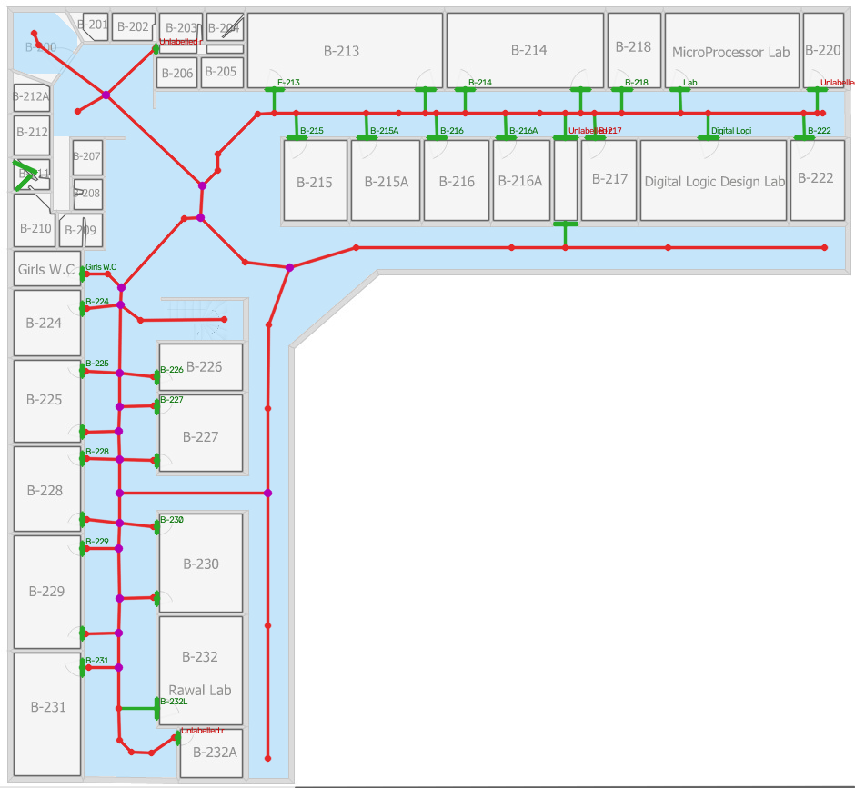
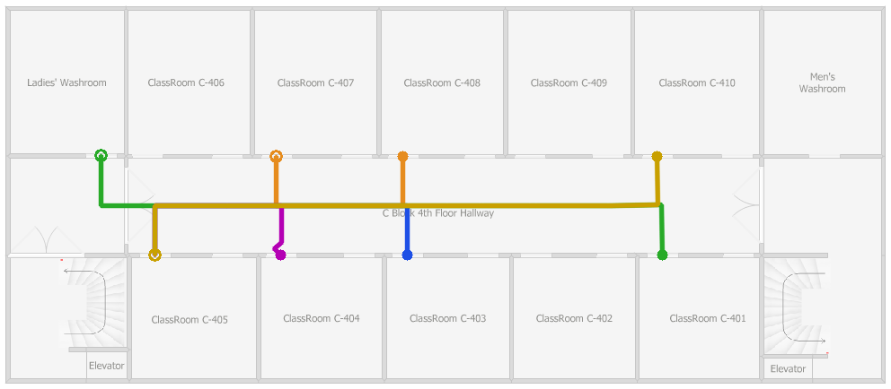

# First results — classical baseline v0.1 on the FAST PDF (2026-10-04)

Built and run in one session (Claude, in claude.ai). Every number below comes from `run_manifest.json` files produced by running the code. Nothing is estimated by hand.

## What was run

- Input: `Floor_Plans_2.pdf` (SHA-256 `8316d9d7…cd38d`), 14 floors, configured in `configs/venues/fast_isb.yaml`.
- Method: classical pipeline (`segment=classical`), default `PipelineParams`.
- Split (ADR-009, *proposed*): **dev = B block**, **test = A + C blocks**.
- Parameters were developed on B floors and synthetic plans only.
- **Scale: no on-site measurements yet.** Every floor uses the `door_width_prior` estimate (median door = 0.9 m). Metric distances are therefore *estimates*.

## Results: "valid package" rate

A floor **passes** when the exported floor.json validates: schema OK, every graph edge inside the walkable area and off walls, and all POI references valid.

| Floor | Split | v1 (untuned, first look) | v2 (after bug fix) | Rooms | Doors | POIs | POIs needing review | Graph nodes | Components | Errors | Scale m/px (est.) |
|---|---|---|---|---|---|---|---|---|---|---|---|
| A-GF | test | FAIL | FAIL | 18 | 22 | 17 | 5 | 305 | 1 | 3 | 0.0265 |
| A-F1 | test | FAIL | FAIL | 18 | 22 | 17 | 10 | 121 | 1 | 6 | 0.0273 |
| A-F2 | test | FAIL | FAIL | 17 | 20 | 17 | 7 | 370 | 1 | 7 | 0.0265 |
| A-F3 | test | FAIL | FAIL | 21 | 28 | 20 | 16 | 157 | 1 | 5 | 0.0273 |
| B-GF | dev | PASS | PASS | 41 | 31 | 22 | 6 | 99 | 1 | 0 | 0.0391 |
| B-F1 | dev | PASS | PASS | 41 | 35 | 25 | 5 | 108 | 1 | 0 | 0.0450 |
| B-F2 | dev | PASS | PASS | 42 | 36 | 25 | 11 | 97 | 1 | 0 | 0.0486 |
| C-B1 | test | PASS | PASS | 3 | 2 | 2 | 2 | 197 | 1 | 0 | 0.0277 |
| C-GF | test | FAIL | FAIL | 5 | 4 | 3 | 1 | 287 | 1 | 5 | 0.0281 |
| C-F1 | test | FAIL | PASS | 8 | 8 | 5 | 0 | 38 | 1 | 0 | 0.0243 |
| C-F2 | test | FAIL | FAIL | 20 | 19 | 3 | 3 | 436 | 11 | 40 | 0.2250 |
| C-F3 | test | FAIL | PASS | 13 | 23 | 13 | 0 | 505 | 1 | 0 | 0.0265 |
| C-F4 | test | FAIL | PASS | 12 | 22 | 12 | 0 | 71 | 1 | 0 | 0.0265 |
| C-F5 | test | FAIL | FAIL | 24 | 11 | 5 | 4 | 1632 | 6 | 41 | 0.0173 |

- v1 = commit `49606b4`, run `runs/all_untuned_v1`: dev 3/3, **test 1/11**.
- v2 = commit `2b99f5f`, run `runs/all_v2_bugfix`: dev 3/3, **test 4/11**. `turn-mapper validate` on the v2 package: PASSED for all 7 packaged floors.
- Runtime: about 1.5–7 s per floor on CPU; 14 floors in about 60 s.

"Valid" doesn't mean "correct". These are validity checks, not accuracy. Accuracy against hand-made ground truth (EVALUATION_PROTOCOL Levels B/C) hasn't been measured yet, because no ground-truth packages exist yet.

### ⚠️ Test-set contamination note

After v1, the A/C overlays were **looked at** to diagnose failures. One change followed: a **code-correctness bug fix**. Skeleton polylines weren't re-oriented when networkx returned an edge reversed, which swapped endpoints and drew straight edges through rooms (regression test: `test_graph_edges_keep_their_geometry_regardless_of_direction`). No thresholds or parameters were changed.

The v1 column is the clean held-out number. For the final FYP evaluation, A and C can no longer count as completely unseen. Use new floors: other buildings, other universities' plans, or plans held back by the team.

## What works (see images)

- **Room/corridor separation by gap closing** works on clean floors. B-F1: 41 rooms; C-F3/C-F4: every classroom and washroom found and linked.
- **Room labels by OCR** on C-F3/C-F4: all POIs labelled correctly ("ClassRoom C-401" …), 0 needing review.
- **A\* routes** between random destinations follow the hallway and enter rooms through their doors.
- **Validators catch real problems.** Every failing floor fails for a visible reason, never silently.

## Failure classes, ranked by how much manual correction they cause

1. **Stairwells and voids treated as walkable** (A-block stair block, "Open to Ground Floor", C-block stair halls). The stair texture makes the skeleton loop around the steps, which explains the high node counts (305–1632) and most EDGE_OUTSIDE_WALKABLE errors.
   → Next feature: stairs/void detection (texture + "Elevator"/"Stairs" OCR) producing `transition` regions excluded from walkable. Develop it on B (B floors have stairs too).
2. **Edited images (C-F2, C-F5):** re-typed serif labels, a JPEG, a cyan highlight, a different resolution. The door-gap estimate (8.5 × wall thickness) is wrong there and door widths are misread, giving a nonsense scale (0.225 m/px).
   → **On-site measurements fix most of this.** With a measured scale, gap closing uses metres (1.6 m), not a thickness ratio.
3. **Small fonts (A block):** OCR misreads labels ("reek", "Oa"), so 5–16 POIs per A floor need review.
   → Higher OCR upscale for small text; per-venue label regex already supported.
4. **Rooms without detectable doors:** sub-cubicles (C faculty offices A–G) and the B-GF passage in front of B-01…B-13. These are reported as ROOM_NO_DOOR / ROOM_NOT_REACHABLE for human correction.
5. **Wide open areas** (C-B1 cafeteria, C-GF library): routable, but the skeleton gives a wandering centre-line. A visibility or grid graph for open areas is planned (PIPELINE1_SPEC §4.9).

## Next steps, in order

1. **Measure on site** (PLAN_INVENTORY §7) and add `scale_evidence` to the venue config. Unblocks metric output and fixes the edited-image floors.
2. Stairs/void detection (develop on B, report on the rest).
3. Ground-truth packages for 2–3 floors (export from the app once the importer exists) → Level B/C metrics.
4. Android importer (Prompt A2) using `contract/fixtures/`.
5. Learned segmenter (M5) vs this baseline.
