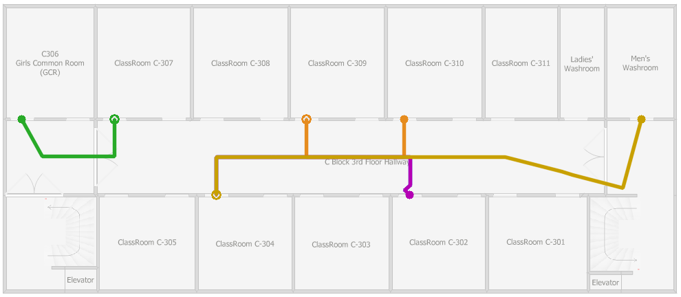
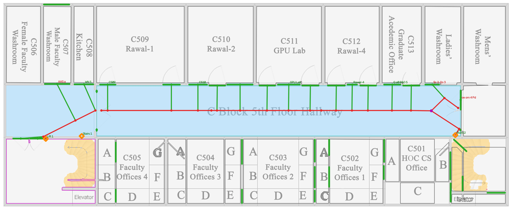

# C-block pass — results (2026-10-04, later the same day)

C block is the main testing building (team decision), so it became a **development** block (ADR-009 rev). A stays held out. Everything below comes from `runs/cblock_v1_all/run_manifest.json`, commit `801d5e4`. Scales are still estimates (no site measurements yet).

## Results

| Floor | Split | Valid | Rooms | Doors | POIs | POIs needing review | Nodes | Graph components | Scale m/px (source) |
|---|---|---|---|---|---|---|---|---|---|
| A-GF | test | PASS | 18 | 22 | 21 | 5 | 88 | 2 | 0.0265 (door_width_prior) |
| A-F1 | test | PASS | 26 | 29 | 19 | 13 | 74 | 1 | 0.0273 (door_width_prior) |
| A-F2 | test | PASS | 25 | 24 | 19 | 8 | 133 | 2 | 0.0265 (door_width_prior) |
| A-F3 | test | PASS | 21 | 28 | 22 | 16 | 133 | 1 | 0.0273 (door_width_prior) |
| B-GF | dev | PASS | 39 | 31 | 23 | 6 | 105 | 1 | 0.0391 (door_width_prior) |
| B-F1 | dev | PASS | 41 | 35 | 26 | 5 | 115 | 1 | 0.0450 (door_width_prior) |
| B-F2 | dev | PASS | 42 | 36 | 26 | 11 | 104 | 1 | 0.0486 (door_width_prior) |
| C-B1 | dev | PASS | 8 | 2 | 5 | 2 | 29 | 1 | 0.0277 (door_width_prior) |
| C-GF | dev | PASS | 19 | 7 | 4 | 0 | 28 | 2 | 0.0281 (door_width_prior) |
| C-F1 | dev | PASS | 10 | 8 | 7 | 0 | 43 | 1 | 0.0243 (door_width_prior) |
| C-F3 | dev | PASS | 13 | 23 | 15 | 0 | 85 | 1 | 0.0265 (door_width_prior) |
| C-F4 | dev | PASS | 12 | 22 | 14 | 0 | 71 | 1 | 0.0265 (door_width_prior) |
| C-F2 | dev | PASS | 29 | 28 | 8 | 1 | 42 | 1 | 0.0191 (footprint_transfer) |
| C-F5 | dev | PASS | 26 | 39 | 12 | 3 | 50 | 7 | 0.0160 (footprint_transfer) |

**14/14 floors produce a valid package** (previously 7/14). Held-out A: 4/4 valid (previously 0/4). Nothing was tuned on A after the earlier diagnostic look (see the RESULTS_2026-10-04.md contamination note); A's gains come entirely from changes developed on B and C.

"Graph components > 1" means some destinations are reported as not reachable. They're listed as warnings in the QA report for a human to fix: rooms whose doors aren't drawn, cubicle clusters, stair halls behind closed doors.

## What changed (all generic: no FAST-specific code)

| Problem seen on C | Fix | Module |
|---|---|---|
| Stairwells made the centre-line loop (hundreds of nodes) | **Stair texture detector**: a smooth grey gradient near the floor colour, unlike flat floor → `transition` nodes + "Stairs n" POIs; rooms labelled "Elevator" → "Lift n" | `segment.detect_stairs`, `transitions.py` |
| Library partitions (thin 1–2 px lines) ignored | **Partition detector**: long straight thin strokes with floor on both sides; door leaves (lines inside a wall gap, incl. double doors) and stair arrows excluded | `segment.detect_partitions`, `vectorize` |
| Re-exported floors (C-F2, C-F5): bold/vertical serif labels read as walls | **OCR in 3 orientations** (0/90/270°), every confident word erased before segmentation | `preprocess.run_ocr` |
| Doors drawn as a white slab *over* an unbroken wall | **Slab carving**: thin white slab along a wall → opening cut through the wall, treated as a door | `vectorize.carve_door_slabs` |
| Cyan highlight halo produced fake slabs | Pixels next to strongly coloured annotation strokes ignored for slabs | `preprocess` colour mask |
| Door-width scale wrong on resized images | **Footprint scale transfer** (`scale_like: C-F3`): floors of the same building share the outline, so scale is carried over by width; aspect mismatch > 3 % is flagged | `api.process_floor`, venue config |
| Rooms with 3 openings into one hall became "corridors" | Circulation = largest space + spaces leading to ≥3 *different* neighbours and reachable from it through doors | `vectorize` |
| Edges valid internally but failing the exported validator | Graph builder uses the **validator's own geometry** (walkable + tolerance − wall bands) | `graph.build_graph` |
| Pixel-by-pixel edges in narrow passages | Greedy "longest valid straight segment" simplification; invalid steps split the line instead of dropping it | `graph.greedy_visible` |
| Small disconnected graph pieces | **Bridging**: shortest valid straight edge, else a routed path through the valid area | `graph._bridge_components` |
| Single-door max 1.6 m over-closed openings | Default `door_max_width_m` = 1.2 m (double doors via partitions/slabs) | `config` |

Tests: 28 passing (5 new: stairs, partitions, slab carving, rotated-OCR mapping, footprint transfer).

## Known gaps on C (for the human pass in the app)

- **Rooms with no drawn door** (library study rooms 1–9, Media Room, Book Shelves; faculty-office cubicles A–G on C-F2/C-F5) are reported as not reachable. That's correct per the drawing; fix in the app editor, or confirm on site.
- **C-F1:** C109 Conference Room and C104 come out walkable (classified as circulation). Review.
- **Stairs anchors** sometimes sit on the stair landing rather than the stair foot. Fine for routing, cosmetic for display.
- **Voids** ("Open to Ground Floor" on A-F1) are still walkable. Needs void detection.
- **Labels on A block** (small font) are often misread. More OCR work needed (upscale, per-room crops at 4×).
- **Scale is estimated everywhere.** Measured distances on **one** C floor (e.g. C-F3) will propagate to C-F2/C-F5 through `scale_like`. Measuring C-F2 and C-F5 directly is still better, since their aspect ratio differs by about 7 %.
