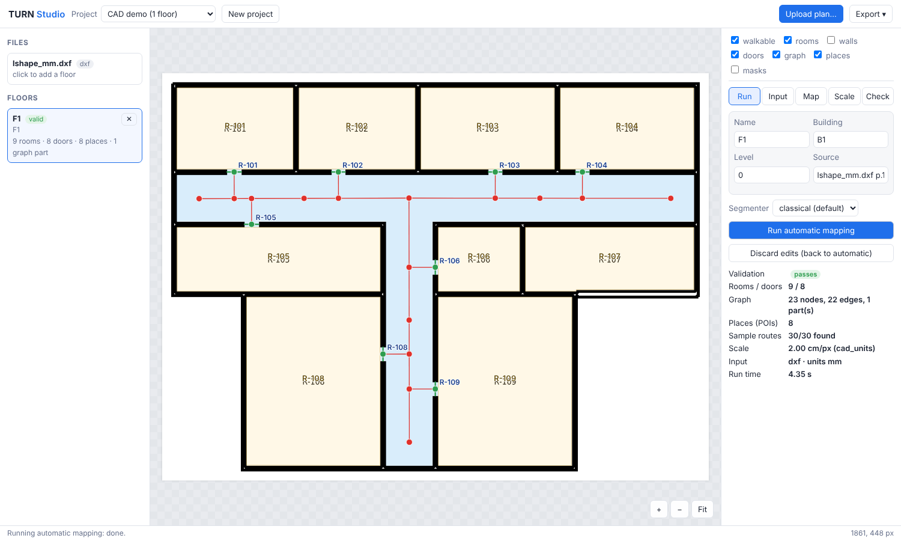

# TURN Studio — user guide

TURN Studio is a local web app for the whole mapping job: upload a plan, get an automatic map, correct it by hand,
and export the files the app imports. It runs on your own computer; nothing is uploaded anywhere.



## Install and start

```bash
pip install -e ".[studio]"          # adds FastAPI, uvicorn, ezdxf, matplotlib
turn-mapper studio                   # opens http://127.0.0.1:8765 in your browser
turn-mapper studio --dir D:/maps --port 8800 --no-browser   # options
```

Projects are saved in `studio_projects/` (git-ignored). The learned segmenter appears when the ML extra and
weights are installed (`pip install -e ".[ml]"`, `TURN_SEG_WEIGHTS=...`).

## Inputs

| Input | How it is read | Scale |
|---|---|---|
| Raster PDF (screenshots, scans) | embedded image at native resolution, or the whole page rendered | door-width estimate (flagged) until you measure |
| **Vector PDF** (CAD export) | page rendered; hairlines thickened | measured, if you type the drawing scale (1:100 …) |
| PNG / JPG / TIFF | as is | door-width estimate until you measure |
| **DXF** (AutoCAD) | chosen layers drawn at 2 cm/px; dimension/annotation/furniture layers off by default | **measured from the drawing units** |
| SVG | rendered | measured if you type the drawing scale |
| DWG | converted to DXF on upload **if** the free ODA File Converter (`ODAFileConverter`) or libredwg (`dwg2dxf`) is installed (or `TURN_DWG_CONVERTER` points at one); otherwise a clear message: save as DXF | measured, as DXF (conversion path tested with a stand-in converter only) |

## Workflow

1. **New project** → **Upload plan…** → pick the page or image → give the floor an id, building and level.
2. **Run** tab → *Run automatic mapping*. The summary shows validation, rooms, doors, graph parts, sample routes,
   scale and run time.
3. **Input** tab (fix the input, then re-run):
   - rotate 90°, **Crop** (drag a rectangle);
   - **Erase brush** for legends, title blocks, stamps, annotation marks (applied before the next run);
   - **Paint masks**: Wall / Floor / Outside, then *Re-run from edited masks* — every later stage (doors, rooms,
     graph, places) is recomputed from your masks. Use it for missed walls, voids drawn as floor, broken corridors.
4. **Map** tab (fix the output; edits save and re-validate automatically):
   - `S` select / drag nodes · `N` add node (chains from the selected node) · `E` add edge · `D` add door
     (two clicks; a door node is added and linked to the nearest node) · `P` add place on a node ·
     `V` draw an area that is **not walkable** (void, shaft) · `W` add walkable area · `Del` delete · `Ctrl+Z` undo;
   - select a room to set its label, name and category, make it non-walkable, or create a place for it.
5. **Scale** tab: click two points with a known real distance (tape-measured on site), type metres; add more
   pairs as checks (residuals shown) → *Apply scale*. All geometry is rescaled; your edits are kept.
6. **Check** tab: errors (block export) and warnings; click one to jump to it. Below them, **Floor links**: with two or
   more floors in a project, stairs and lifts on adjacent levels of a building are paired automatically
   (same type, nearest position after aligning the floors' corners, 4 m cap). Unpaired ones are listed as
   warnings, never guessed. Pick two nodes on different floors and *Add manual link* to override. Links go into
   `venue.json` → `transitions`. Lengths are flagged estimates (stairs 6 m, lift 4 m) until measured.
7. **Export ▾**: `venue.json` + images (what the Android app imports), `.turnmap`, GeoJSON (QGIS / debugging),
   SVG (print, report), **training annotations** (image + class mask per floor, for fine-tuning the learned
   segmenter). Copies are also kept in the project's `exports/` folder.

Provenance is kept per element: `auto` (pipeline), `corrected` (pipeline output you changed) and `manual` (added
by you), as the contract requires.

## Where things are

```
studio_projects/<project>/project.json            floors, settings, scale evidence
studio_projects/<project>/input/                  uploaded files
studio_projects/<project>/floors/<id>/base.png    plan after crop/rotate
                                     erase.png    input erase mask
                                     masks.png    wall/floor/outside labels (auto or painted)
                                     auto.json    last automatic result
                                     floor.json   current result with your edits
studio_projects/<project>/exports/<time>/         every export
```

Floor plans can be private: keep `studio_projects/` out of git (it is in `.gitignore`).
