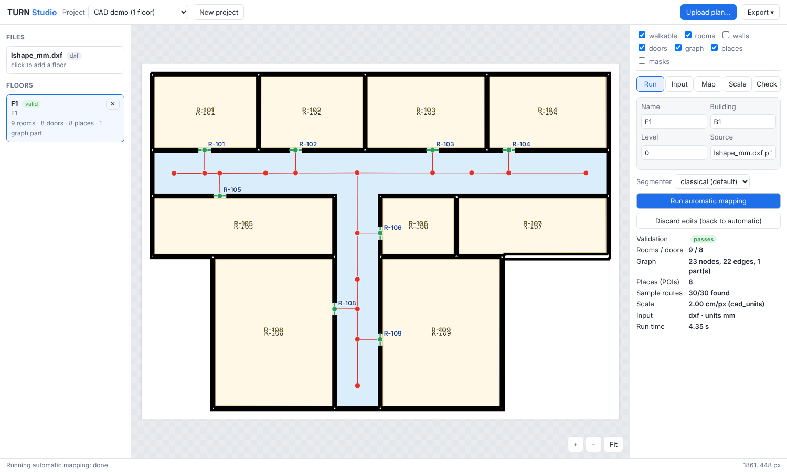

# TURN Studio — user guide

TURN Studio is a local web app for the whole mapping job: upload a plan, get an automatic map, correct it by hand,
and export the files the app imports. It runs on your own computer; nothing is uploaded anywhere.



## Install and start

```bash
pip install -e ".[studio]"          # adds FastAPI, uvicorn, ezdxf, matplotlib, RapidOCR (room labels)
turn-mapper studio                   # opens http://127.0.0.1:8765 in your browser
turn-mapper studio --dir D:/maps --port 8800 --no-browser   # options
```

Projects are saved in `studio_projects/` (git-ignored). The learned segmenter appears when the ML extra and
weights are installed (`pip install -e ".[ml]"`, `TURN_SEG_WEIGHTS=...`).

**Room labels (OCR).** Labels such as *B-215A* or *Maker Lab* are read from the plan's own text. Studio uses
Tesseract if it is installed (found on PATH, via `TESSERACT_CMD`, or in `C:\Program Files\Tesseract-OCR`),
otherwise RapidOCR, which comes with `.[studio]` and needs no separate program. The header badge shows which
one is active; **Labels: OFF** means neither is available and rooms will be "Unlabelled". Force one with
`TURN_OCR=rapidocr|tesseract`.

## Inputs

| Input | How it is read | Scale |
|---|---|---|
| Raster PDF (screenshots, scans) | embedded image at native resolution, or the whole page rendered | door-width estimate (flagged) until you measure |
| **Vector PDF** (CAD export) | page rendered; hairlines thickened | measured, if you type the drawing scale (1:100 …) |
| PNG / JPG / TIFF | as is | door-width estimate until you measure |
| **DXF** (AutoCAD) | chosen layers drawn at 2 cm/px; dimension/annotation/furniture layers off by default | **measured from the drawing units** |
| SVG | rendered | measured if you type the drawing scale |
| DWG | converted to DXF on upload **if** the free ODA File Converter (`ODAFileConverter`) or libredwg (`dwg2dxf`) is installed (or `TURN_DWG_CONVERTER` points at one); otherwise a clear message: save as DXF | measured, as DXF (conversion path tested with a stand-in converter only) |

## Workflow

1. **New project** → **Upload plan…** → pick the page or image → give the floor an id, building and level.
2. **Run** tab → *Run automatic mapping*. The summary shows validation, rooms, doors, graph parts, sample routes,
   scale and run time.
3. **Input** tab (fix the input, then re-run):
   - rotate 90°, **Crop** (drag a rectangle);
   - **Erase brush** for legends, title blocks, stamps, annotation marks (applied before the next run);
   - **Paint masks**: Wall / Floor / Outside, then *Re-run from edited masks* — every later stage (doors, rooms,
     graph, places) is recomputed from your masks. Use it for missed walls, voids drawn as floor, broken corridors.
4. **Map** tab (fix the output; edits save and re-validate automatically):
   - `S` select / drag nodes · `N` add node (chains from the selected node) · `E` add edge · `D` add door
     (two clicks; a door node is added and linked to the nearest node) · `P` add place on a node ·
     `V` draw an area that is **not walkable** (void, shaft) · `W` add walkable area · `Del` delete · `Ctrl+Z` undo;
   - select a room to set its label, name and category, make it non-walkable, or create a place for it;
   - doors: a **solid** line is a door swing read from a CAD PDF (confidence 0.95); a **dashed** line is a gap
     in the walls the pipeline took for a door (confidence 0.7) — check those first, they can be a missing wall.
     The door inspector says which it is.
5. **Scale** tab: click two points with a known real distance (tape-measured on site), type metres; add more
   pairs as checks (residuals shown) → *Apply scale*. All geometry is rescaled; your edits are kept.
6. **Check** tab: errors (block export) and warnings; click one to jump to it. Below them:
   - **Floor links**: with two or more floors in a project, the floors of each building are first aligned by
     their wall drawings (shared building frame), then stairs, lifts and escalators on adjacent levels are paired
     by type and position (optimal matching, 8 m cap). A floor whose scale was only estimated is rescaled when
     its walls line up with a *measured* floor of the same building (project setting `correct_scales`, on by
     default); measured floors are never changed. Unpaired nodes are listed as warnings, never guessed; a lift
     seen on two non-adjacent floors at the same place gets `LINK_SHAFT_GAP` naming the floors to mark it on.
     Pick two nodes on different floors and *Add manual link* to override. Each floor also gets a grade:
     **ready** (one graph piece, every destination reachable, measured scale, every stair/lift linked),
     **usable**, or **needs work**, with what is missing. Links go into `venue.json` → `transitions`. Lengths
     are flagged estimates (stairs 6 m, lift 4 m) until measured.
   - **Connections between buildings**: a walkway, bridge or ramp that joins two floors (usually the same level
     of two buildings). Pick the two floors and, for each, the edge of the drawing where the corridor leaves
     (left / right / top / bottom) or type an exact node id; choose the type and, if known, the length. A
     connection given by an edge is marked as an estimate (`LINK_ENDPOINT_ESTIMATED`) until you replace the
     edge with a node. Connections are never guessed. Stored in the project and exported as `transitions`.
   - **Lifts**: found from the lift shaft's label ("Elevator", "Lift") anywhere on the plan, or from the learned
     model's lift class. If a lift is found on two floors but not on a floor between them, a stop is proposed
     there when a graph node is within 4 m of the shaft (`LINK_SHAFT_INFERRED`, low confidence); otherwise
     `LINK_SHAFT_GAP` names the floor to mark it on.
   - **Route across floors**: pick a start and a destination (any floor), optionally *step-free* (lifts, ramps,
     walkways only), *Route*. The summary gives length, time and floors; the steps read like "Take the stairs
     up 2 floors to …"; *Show <floor>* switches the canvas to a floor, where its leg is drawn.
7. **Edit as CAD** (any input -> editable CAD): *Export ▾ → Editable CAD (DXF)* writes the extracted plan in
   metres: `A-WALL` (each wall a centre line with its thickness; door openings are gaps), `A-AREA-IDEN` (room
   labels as text), and reference layers `TURN-DOORS`, `TURN-ROOMS`, `TURN-GRAPH`, `TURN-PLACES` that are ignored
   on load. Open it in AutoCAD / LibreCAD / QCAD, move or delete walls, change labels, save, then **Upload** the
   DXF as a new file: it is read with a *measured* scale and goes through the same pipeline. Tested: PNG -> DXF
   -> back gives identical rooms/doors/places on the synthetic plan and on FAST C-F3 and C-F4; deleting a wall
   in the DXF merges the two rooms. Messy floors lose some rooms on the way back (FAST C-F5: 16 of 30), so check.
8. **Export ▾**: `venue.json` + images (what the Android app imports), `.turnmap`, GeoJSON (QGIS / debugging),
   SVG (print, report), **training annotations** (image + class mask per floor, for fine-tuning the learned
   segmenter). Copies are also kept in the project's `exports/` folder.

Provenance is kept per element: `auto` (pipeline), `corrected` (pipeline output you changed) and `manual` (added
by you), as the contract requires.

## Where things are

```
studio_projects/<project>/project.json            floors, settings, scale evidence
studio_projects/<project>/input/                  uploaded files
studio_projects/<project>/floors/<id>/base.png    plan after crop/rotate
                                     erase.png    input erase mask
                                     masks.png    wall/floor/outside labels (auto or painted)
                                     auto.json    last automatic result
                                     floor.json   current result with your edits
studio_projects/<project>/exports/<time>/         every export
```

Floor plans can be private: keep `studio_projects/` out of git (it is in `.gitignore`).
