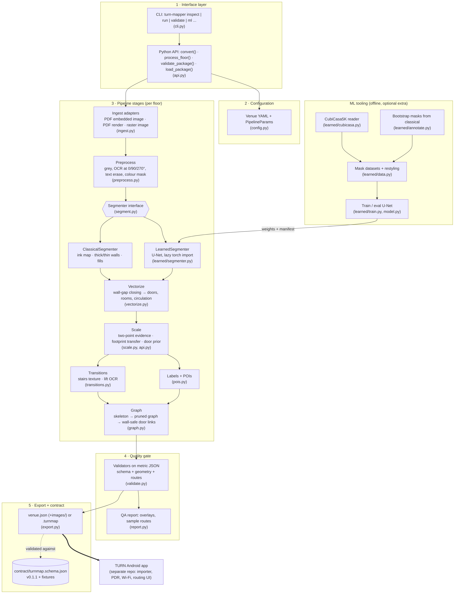
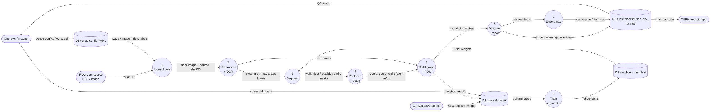
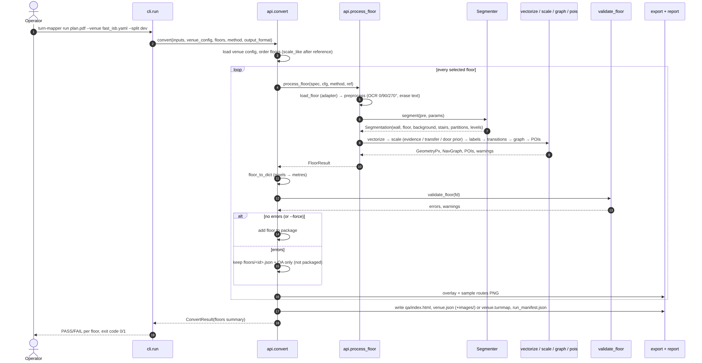
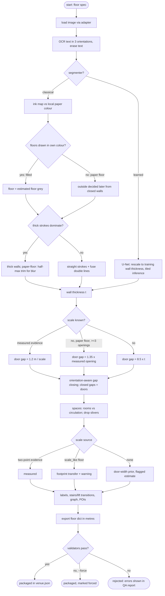
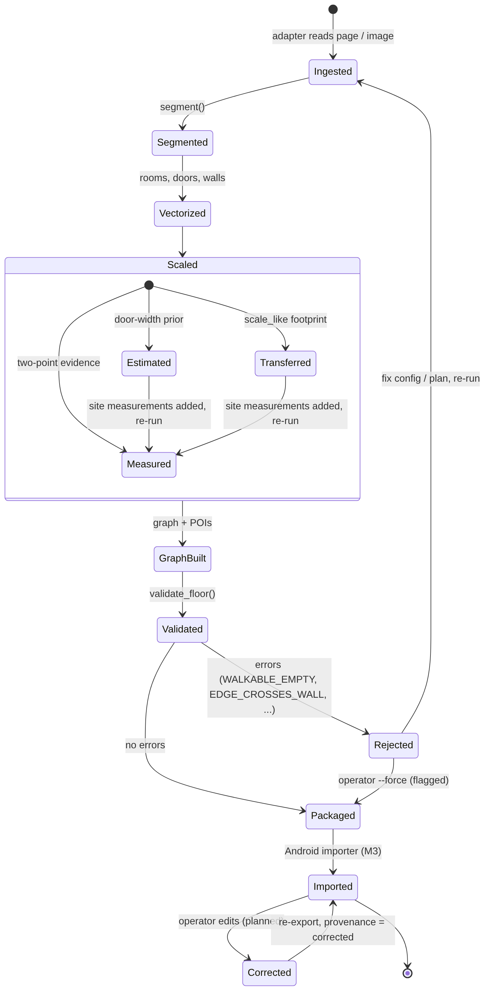
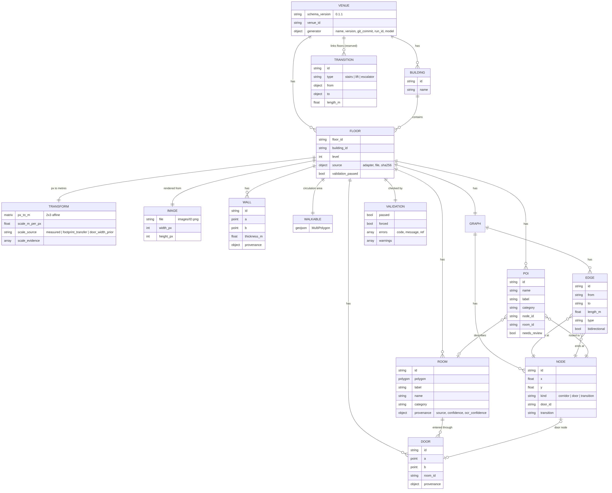
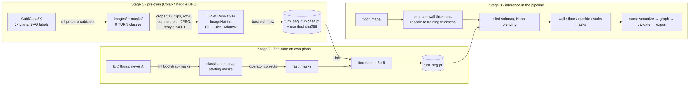

# Design: TURN-Mapper (as built, v0.3.0)

Every diagram here was drawn from the current code (commit tagged `v0.3.0`). The sources are in [`diagrams/`](diagrams/) as Mermaid `.mmd` files, which GitHub renders, with `.png` exports for the report and slides. Each diagram is followed by what it shows and why it is built that way.

## 1. Architecture (layers, components, dependencies, interfaces)

**Layers** (dependencies point downwards only):

1. **Interface**: the `turn-mapper` CLI and the Python API (`api.py`). The CLI is a thin wrapper, so everything the CLI can do is scriptable and testable.
2. **Configuration**: `configs/venues/*.yaml` describes *where* the floors are (PDF page, image index, building, level, test split) and venue facts such as room-label patterns. It holds no colours or thresholds; `PipelineParams` holds generic defaults.
3. **Pipeline stages**: one module per stage, each with a typed input and a typed output defined in `ir.py` (`FloorImage → Preprocessed → Segmentation → GeometryPx → NavGraph/POIs`).
4. **Quality gate**: validators run on the exported metric JSON, not on internal state, and the QA report is generated for every floor.
5. **Export and contract**: `venue.json` or `.turnmap`, validated against `contract/turnmap.schema.json`. The contract is the only thing the Android app depends on.

**ML tooling** sits beside the pipeline. Its only connection to it is the weights file read by `LearnedSegmenter`.

**Interface contracts:**

| Interface | Contract | Why |
|---|---|---|
| `Segmenter.segment(pre, params) -> Segmentation` | `wall`, `floor`, `background` boolean masks + `stairs`/`partitions` + `levels` | Lets classical and learned segmentation swap without touching the 6 later stages (ADR-018) |
| `api.convert(inputs, venue_config, out_dir, floors, method, force, output_format) -> ConvertResult` | Public entry point; returns per-floor summaries and file paths | The single surface for the CLI, tests, notebooks and the app team |
| Ingest adapter registry (`ADAPTERS`) | `can_handle(spec) -> score` / `load(spec) -> FloorImage`; highest score wins | New formats (vector PDF, DXF) are added as new adapters, never as special cases |
| `venue.json` / `.turnmap` (schema 0.1.1) | JSON Schema + fixtures + error codes | Python ↔ Android boundary; versioned with semver and a changelog |

**Design choices and justification:**

| Choice | Alternatives considered | Why this one |
|---|---|---|
| Classical CV first, learned segmenter second, behind one interface | End-to-end deep model from day one | No labelled institutional data existed. Classical gives a working baseline, an evaluation reference and starting labels for the DL model (ADR-018). |
| Doors found by *closing wall gaps* (closed gap = door) | Detecting door symbols (arcs) | Door symbols vary by convention and are often missing. Gaps in walls are universal. |
| Graph from the skeleton of free space, pruned and linked through doors | Grid graph, visibility graph | Gives few nodes, follows corridor centres and stays readable for operators. Edges are checked against walls. |
| Validators on metric JSON | Assertions inside stages | The same checks apply to our output, hand-edited packages and app ground truth (ADR-013). |
| Scale is never silent | Assume a DPI or a fixed scale | Each map states `scale_source`: measured, footprint transfer or door-width prior. Estimates are flagged (ADR-012/015). |
| JSON by default, zip optional | Zip only | Easier to inspect and diff, simple for the app to read; the zip is still available for one-file transfer. |
| Grey input and restyling for the DL model | Train on CubiCasa colours | Plan sources differ in colour. Restyling teaches shape, not one dataset's palette. |

## 2. Data-flow diagram (level 1)

- **External entities:** the operator, the plan source, the Android app and the CubiCasa5K dataset.
- **Data stores:**
  - D1: venue config;
  - D2: run outputs (per-floor JSON, QA report, manifest, `venue.json`);
  - D3: model weights and their manifest;
  - D4: mask datasets.

The main flow (processes 1→7) runs once per floor. The training flow (CubiCasa or corrected masks → process 8 → D3) is offline and feeds back only through the weights file.

Two flows matter for evaluation:

- The QA report goes back to the operator, which is the human-in-the-loop step.
- The bootstrap masks go into D4, so the classical result reduces annotation effort.

## 3. Sequence: `turn-mapper run`

- Floors that borrow their scale from another floor (`scale_like`) are processed after their reference.
- A floor with validation errors still gets its JSON and QA overlay, so the operator can see *why* it failed, but it is left out of the package unless `--force` is given.
- The CLI exit code is non-zero if any floor failed, so the pipeline can be used in scripts and CI.

## 4. Activity: one floor, with the decisions taken inside `process_floor`

This diagram shows the business logic added since the proposal POC: drawing-style detection (filled or paper floor, thick or thin walls), the three ways of choosing the door-gap size, the three scale sources, and the validation gate.

## 5. State: life of a floor map

The *Scaled* sub-state matters for the FYP's honesty rule. A map with `door_width_prior` or `footprint_transfer` scale is usable for routing, but it is reported as an estimate until site measurements move it to *Measured*. *Imported* and *Corrected* belong to the app integration (M3) and the correction workflow, both planned.

## 6. Data model (output package, schema 0.1.1)

- All geometry is in metres in one frame per floor. `transform.px_to_m` maps image pixels to metres, so the app can draw the plan image under the map.
- Rooms, doors, walls, graph nodes and edges, and POIs each have an `id`. Every automatic element carries `provenance` (source, confidence).
- POIs reference a graph node, which is what the router needs, and a room, which is what the UI shows.
- `TRANSITION` is reserved for multi-floor linking (M9). Single-floor transition *nodes* already exist (`node.kind = transition`).

## 7. ML pipeline (pre-train → fine-tune → inference)

## 8. Changes since the proposal

| Area | Proposal (POC) | Now | Why it changed | Evidence |
|---|---|---|---|---|
| Module boundary | Mapping inside the app | Separate Python module + versioned JSON contract | Independent development and testing; the app only depends on the contract | `docs/INTEGRATION_CONTRACT.md`, `contract/` |
| Map creation | DL model to extract walls and rooms | Classical CV baseline now; DL segmenter as a pluggable stage | No labelled institutional plans existed; the baseline delivers a working system and starting labels | ADR-018, `segment.py`, `learned/` |
| Input generality | FAST plans | Any raster plan: 6 drawing conventions tested, 11/12 fully correct | Supervisor and panel asked for "any floor plan" | `RESULTS_GENERALITY_2026-10-11.md` |
| Scale | Not specified | Explicit scale sources, transfer between floors, flagged estimates | Metric maps are required for PDR and routing distances | ADR-012, ADR-015 |
| Quality control | Manual check | Automated validators + QA report + `--force` audit trail | "AI output is a proposal"; errors must be visible | `validate.py`, FR-11 |
| Stairs and lifts | Not in POC | Transition nodes and POIs | Needed for multi-floor routing | ADR-014 |
| Output | `.turnmap` zip | `venue.json` default (+ zip optional), schema 0.1.1 | Easier inspection and app import | `contract/CHANGELOG.md` |
| Test scope | One floor | Pilot building C (main test), B dev, A held out | Narrowed after scope feedback; held-out building for honest evaluation | ADR-009 |
| Vector/DXF input | Planned early | Deferred (M7) | The FAST PDF is raster (inspection showed 0 vector drawings) | `PLAN_INVENTORY.md` |
